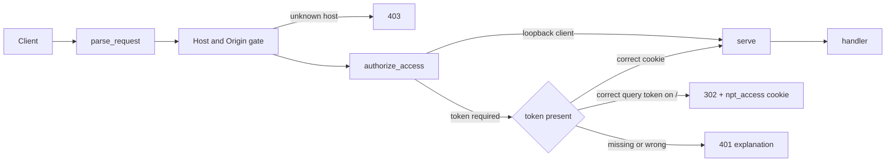

# Design Document: console-access

## Overview

The change adds a small access-control layer to `web/server.py`, extends the audit record, bounds two log files, warns about loose configuration permissions, makes configuration writes retry on Windows and removes a trailing newline byte from the recorded node account name.

The console stays a standard-library `ThreadingHTTPServer`. No new runtime dependency and no new service are introduced.

## Access control flow



### State

`web/server.py` holds one module-level record:

```python
ACCESS = {"token": "", "required": False, "printed": False}
```

`run_server` resolves it once, before the server starts serving:

- `NET_PROXY_ACCESS_TOKEN` holds a non-empty value: that value is the token and access is required.
- The bind address is not loopback: a random `secrets.token_urlsafe(32)` token is generated and access is required.
- Otherwise: no token, access is not required.

The generated token is printed once, as an access link that includes the token, because the operator has no other way to learn it.

### Client classification

`is_loopback_client(address)` accepts `127.0.0.0/8` and `::1`, and unwraps an IPv4-mapped address such as `::ffff:127.0.0.1` before deciding.

### Token handling

`authorize_access` runs inside `parse_request`, after the Host and Origin gate.

- A loopback client is always allowed.
- Otherwise the request must carry a correct `npt_access` cookie, compared with `hmac.compare_digest`.
- The console root may instead carry a `token` query parameter. A correct value sets the cookie and answers HTTP 302 to `/`; a wrong value answers HTTP 401.
- The cookie is `HttpOnly`, `SameSite=Strict`, `Path=/`, so a script on another origin cannot read it and it is not sent on a cross-site request.

### Redaction

`log_request` replaces the value of a `token` query parameter with `<redacted>` before the line reaches the console log. The token never appears in an API body, an audit record or an error message.

### Host gate for a published console

`console_host_names()` collects the names and addresses that identify this machine: `localhost`, `127.0.0.1`, `::1`, the machine host name and the source addresses of the local interfaces. The interface addresses are found by connecting an unbound UDP socket, which selects a source address and sends no packet; no DNS name is resolved.

When access control is active, the allowed Host list is extended with those names. When access control is not active, the strict list is unchanged, so the loopback console keeps its current DNS-rebinding protection.

## Audit records

`write_audit_log` stores an ISO 8601 timestamp and the client address. The handler writes through a small helper that passes `self.client_address[0]`. The existing `operator_ip` key keeps its meaning and receives the client address as well, so older readers keep working.

## Log rotation

`rotate_log(path, limit, keep)` renames `path` to `path.1`, shifts the older generations and removes the last one. It runs before an append when the current file has reached the limit.

- `audit.log`: 5 MiB, three generations.
- `console.log`: 10 MiB, one previous generation. The launcher rotates before it opens the file for appending.

## Configuration permissions

`config_permission_warning(path)` returns a message when the file exists, the platform reports POSIX modes and the mode grants read access to group or other. It names the file and the mode and contains no configuration content. `run_server` prints it on stderr at startup.

## Reliable configuration writes

`sdk/config.atomic_json` replaces the target with a bounded retry: up to five attempts with a growing delay, applied only when the failure is a permission error, which is what Windows reports while another process holds the file open. Any other error is raised immediately, and the original error is raised when the attempts run out. The temporary file is removed as before.

## Exact node identity

The read-only baseline wrote the account name with `id -un | hex`, which hexed the trailing newline byte as well, so the decoded name ended with `\n` and never equalled the local identity helper. The probe now writes `printf '%s' "$(id -un)" | hex`, which drops the newline before hashing.

## Correctness properties

This task adds no new property module. The existing P1–P6 properties in `test/test_prop_console.py` keep covering the request boundary that the access layer sits in front of, and the new behaviours are covered by focused unit tests.

## Error handling

- Unknown Host: 403, unchanged.
- Missing or wrong token from a non-loopback client: 401 with an explanation page and no cookie.
- Rotation failure: the append is skipped and the failure is reported on stderr; the console keeps running.
- Configuration write failure after the retries: the original error is raised and the previous configuration is untouched.

## Testing strategy

`test/test_console_access.py` covers the token flow, the Host gate, the audit fields, the audit rotation and the redaction of the request log.

`test/test_runtime_reliability.py` covers the configuration write retry, the permission warning, the console log rotation and the account-name fix. The account-name test runs the real probe line under `sh` and decodes the emitted value, so it fails when a newline byte returns.

All tests set `NET_PROXY_CONFIG` to a temporary path, bind port 0 and never contact a real destination.

## Decisions

1. **Enforce by client address, not by bind address.** A console published on `0.0.0.0` is still safe for local software: the operator's own browser connects from loopback and is not asked for a token. Only genuinely remote clients must authenticate.
2. **A query token that becomes a cookie.** Browsers cannot set a cookie for another origin, and the console has no login form. The link with the token is handed to the operator once; the cookie then carries the session.
3. **Rotate rather than truncate.** Truncating loses the history that makes an audit trail useful.
4. **Retry only permission errors.** A full disk or a read-only directory must fail loudly instead of being retried.
5. **Extend the Host list only when access control is active.** The loopback console keeps the strictest possible Host rule.
