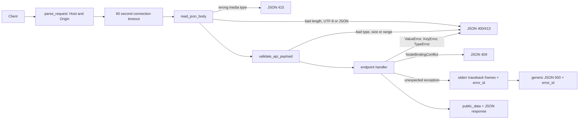

# Design Document: console-hardening

## Overview

The change keeps the existing `ThreadingHTTPServer` architecture and adds a validation boundary inside `ProxyConsoleHandler.do_POST`. The boundary reads one bounded JSON object, normalizes recognized primitives, caches that object for the selected handler and rejects invalid data before any configuration, socket or subprocess work. Existing endpoint semantics remain intact. Successful `/api/run` responses remain finite Server-Sent Events; its validation and error responses remain JSON.

The implementation stays in `web/server.py` and `sdk/config.py`. No runtime dependency or new network service is introduced.

## Request flow

## Components and interfaces

### Validation primitives (`web/server.py`)

- `text_field(value, name, *, maximum, strip=True) -> str` rejects non-strings, NUL, oversized values and unpaired Unicode surrogates.
- `integer_field(value, name, *, minimum, maximum) -> int` accepts integers and decimal strings, but rejects Booleans and all other types.
- `boolean_field(value, name) -> bool` accepts only JSON Booleans.
- `normalize_protocol(value) -> str` trims and lower-cases a string, then accepts only `http`.
- `validate_api_payload(path, payload) -> dict` copies and normalizes recognized fields. Unknown fields stay available for existing forward-compatible handlers but cannot bypass validation of a recognized field.
- `validate_node_selections(value) -> list` accepts at most 256 objects and validates `node_id`, `node_revision`, `binding_revision` and `gateway_id` in every item.

String limits are field-specific: identifiers and account/container fields 128, names and hosts 255, descriptions/passwords/no-proxy 4096, and request URLs or curl text 8192. Revision integers are -1 through `2**53 - 1`, where -1 proceeds to the existing stale-revision conflict check; ports are 1 through 65535. `tags` is an array of at most 64 strings, each at most 128 characters.

`validate_client` requires an object and validates every field it reads, so a non-object or an object without `host` raises `ValueError` instead of `AttributeError` or `KeyError`. `diagnostic_command` rejects CR and LF before stripping, so a trailing newline cannot hide a second request line.

`validate_host_port` first validates types and lengths, then accepts a DNS-style host, IPv4 or bracket-free IPv6 with an optional safe zone. It never resolves DNS. `diagnostic_url`, `diagnostic_command`, `validate_bypass`, `validate_client`, `gateway_url` and the API handlers call typed primitives before string or integer operations.

### JSON body reader

`read_json_body` checks the request headers before reading. It rejects any `Transfer-Encoding` header and any request with more than one `Content-Type` header, both with a 400 and a closed connection, because a request whose framing is ambiguous must never reach a handler. It then requires exactly one `Content-Type` header whose media type is `application/json`, accepting media-type parameters such as `charset=utf-8`; a missing or different media type is a 415.

It requires exactly one valid non-negative Content-Length and caps it at 1 MiB. A body length over the cap raises `RequestError(413, ...)` and marks the connection for closure. Invalid UTF-8, invalid JSON, JSON nested deeper than the parser allows and non-object JSON raise a 400 `RequestError`.

`do_POST` reads and validates the body once, stores it in `_request_json`, and handlers continue to call `read_json_body`; the method returns the cached object on those calls. The cache is removed in `finally`.

### HTTP errors and internal logging

`RequestError` carries an HTTP status and a public message. `UnsupportedMediaType` uses status 415. Existing `NodeBindingConflict` remains a 409.

`send_internal_error` creates an Error ID with the standard library, writes the ID, exception class and formatted traceback frames to stderr, and sends a generic JSON 500. It never formats `str(exc)`, request values or traceback locals. The launcher already redirects console stderr to `console.log`, so no second logging system is added in this task.

`do_GET` and `do_POST` use the same internal-error helper. Socket timeout exceptions close the connection; they do not retry a partial body or invoke a handler.

### Connection timeout

`ProxyConsoleHandler.setup` calls the base setup and sets `self.connection.settimeout(60)`. This bounds header and body reads. Existing transport functions keep their shorter operation-specific timeouts.

### Gateway normalization

`gateway_url`, gateway add, gateway test and gateway update use `normalize_protocol`. Update builds a draft copy, validates it and only then mutates the saved gateway. This also preserves the previous valid gateway after a rejected update.

### Audit warnings

`write_audit_log` writes a fixed warning containing only the exception class to stderr. It does not include `details` or `str(exc)`.

## Correctness properties

Each property runs with at least 100 examples in the CI profile and names this spec and requirement in its module docstring.

### P1: Proxy URL round trip

*For any* valid DNS, IPv4 or IPv6 gateway host, port and no-proxy string, `proxy_environment` produces the same HTTP proxy URL in all six proxy keys, the same bypass value in both bypass keys, and `urlsplit` recovers the original host and port. IPv6 hosts are enclosed in brackets exactly once. `gateway_url` produces the same URL.

**Validates: Requirements 4.3 and 7.1**

### P2: Validators are total over generated JSON values

*For any* generated JSON value supplied to each typed primitive and public validator, the validator either returns a value that satisfies its type, size, range and grammar or raises `ValueError`. It never raises another exception.

**Validates: Requirements 1.2, 1.5 and 4.2**

### P3: Diagnostic request parsing is shell-free

*For any* valid HTTP(S) URL without credentials or control characters, parsing the URL directly and parsing its safely quoted `curl --url` form recover the same URL and GET method. Any request text containing `$(`, a backtick, CR or LF is rejected before execution.

**Validates: Requirements 1.2 and 7.1**

### P4: Public responses remove sensitive keys recursively

*For any* JSON tree of bounded depth and any casing of a Sensitive key inserted at any object depth, `public_data` removes every such key while preserving non-sensitive siblings and list shape.

**Validates: Requirements 3.5 and 7.1**

### P5: Configuration writes are atomic and round-trip

*For any* valid generated configuration extension that contains JSON values, `save_config` followed by `load_config` preserves it. If replacement fails after the temporary file is written, the original configuration bytes remain unchanged and no temporary file remains.

**Validates: Requirements 7.1**

### P6: Generated POST bodies never expose an implementation failure

*For any* registered endpoint and generated JSON object, with configuration and transports isolated, the response is never an accidental HTTP 500 caused by input shape. JSON responses parse successfully and contain no Sensitive key. A successful `/api/run` response may use `text/event-stream`; every `data:` payload in that response is valid JSON and contains no Sensitive key. A deliberately injected internal exception is tested separately and must return the specified generic 500 with an Error ID.

**Validates: Requirements 1.1, 1.2, 3.2, 3.5 and 7.1**

## Error handling

- Unsupported media type: JSON 415.
- Missing, malformed or negative Content-Length; malformed UTF-8/JSON; wrong field type/range: JSON 400.
- Body over 1 MiB: JSON 413 and connection close.
- Stale node or gateway binding: JSON 409.
- Unknown route: existing 404 behavior.
- Socket read timeout: close the connection; no handler or state change.
- Unexpected exception: generic JSON 500 plus Error ID; traceback frames only on stderr.

## Testing strategy

`test/test_console_hardening.py` covers HTTP media types, body limits, safe 500 responses, stderr traceback evidence, request timeout, `/api/test-host`, protocol normalization and rejected-update atomicity. `test/test_prop_console.py` implements P1 through P6 with local port-0 servers and patched transports. Existing Web, management, lifecycle and diagnostics suites remain regression coverage.

All tests set `NET_PROXY_CONFIG` to a temporary path. They never read the repository configuration, bind port 8899 or contact a real destination.

## Decisions

1. **Central validation before handlers.** This closes the whole class of `.strip()` and `int()` crashes without duplicating type checks in every route.
2. **Keep successful `/api/run` as SSE.** The current UI consumes its event stream. Changing it to ordinary JSON would be an unrelated compatibility break; malformed and failed requests still return JSON.
3. **Do not log exception messages.** Traceback frames and the exception class are enough to locate a bug, while arbitrary exception strings can contain request values or credentials.
4. **Socket timeout, not forced thread termination.** Python cannot safely kill a handler thread. The 60-second socket timeout bounds incomplete clients; every network and subprocess operation retains its own shorter timeout.
