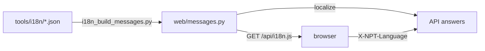

# Design Document: console-i18n

## Overview

The catalogue is built once from the sources in `tools/i18n/` and shipped as `web/messages.py`. The browser receives it from `/api/i18n.js`, applies the `data-i18n` attributes and offers `t()` to the script. The server uses the same module to localize the `error` and `message` fields of an answer.

## The catalogue

| Source | Holds |
| --- | --- |
| `tools/i18n/index.zh-CN.json` | The Chinese text of every static element |
| `tools/i18n/index.en.json` | Its English text |
| `tools/i18n/app.zh-CN.json` | The Chinese text of every dynamic string |
| `tools/i18n/app.en.json` | Its English text |
| `tools/i18n/server.en.json` | The English text of the API messages, keyed by their Chinese text |

`tools/i18n_build_messages.py` merges the sources and writes `web/messages.py`. It refuses to write when a key is missing in one language, so a half-translated catalogue cannot reach the repository.

The API messages are keyed by their Chinese text, because the server sends that text and the browser never sees the key. `localize(value, language)` looks the text up and returns the translation, or the text itself when the catalogue does not know it.

## The browser

`web/static/i18n.js` runs before `app.js`:

- `detectLanguage()` reads `localStorage["npt-lang"]`, and otherwise defaults to `"en"`.
- `t(key, values)` returns the message in the current language and fills `{name}` placeholders.
- `applyTranslations(root)` writes the message of every `[data-i18n]`, `[data-i18n-title]`, `[data-i18n-placeholder]` and `[data-i18n-aria-label]` element. An element with child elements keeps them.
- `setLanguage(value)` stores the choice, sets the `lang` attribute, re-applies the translations and dispatches an `npt-language` event.
- The `fetch` wrapper adds the `X-NPT-Language` header to the API requests of the console.

`app.js` listens for `npt-language` and re-renders the tables, so that the text it builds with `t()` follows the change.

A missing catalogue leaves the English static text of the page untouched, and an unknown key shows the key itself.

## The server

`GET /api/i18n.js` answers with `window.NPT_MESSAGES = {...};` and a JavaScript content type. The content security policy of the console allows a script of the same origin, so the file is served from the console itself.

`ProxyConsoleHandler.send_json` localizes the `error` and `message` fields of the answer with the language of the request (defaulting to `"en"` when no `X-NPT-Language` header is sent), then applies `public_data` and sends it.

## Error handling

- A missing catalogue: the page keeps its English text.
- An unknown key: the key itself is shown.
- An unknown language in the header: the default language (`"en"`) is used.
- A message that the catalogue does not know: it is returned unchanged.

## Testing strategy

`test/test_console_i18n.py` checks the catalogue, the keys used by the page and the script, the normalization of a language, English defaults across static HTML/API/`config.example.json`/`demo.py`, and the localization of an API answer.

`packaging/test_browser_i18n.py` checks English by default, Simplified Chinese, the toggle and persistence on reload.

The other browser checks pin the Chinese language when asserting Chinese text.

## Decisions

1. **One catalogue, served by the console.** The browser and the server read the same texts, so an answer can never contradict the page.
2. **The API messages are keyed by their text and default to English.** The server translates internal messages via `web/messages.py` with `DEFAULT_LANGUAGE = "en"` when no language header is present.
3. **English-first with one-click bilingual toggle.** Any first-run browser or unheaded API consumer receives English immediately, while clicking the top-bar toggle switches both UI and API answers to Simplified Chinese cleanly.
4. **The build fails on a missing translation.** A half-translated catalogue is a build error, not a silent gap.
