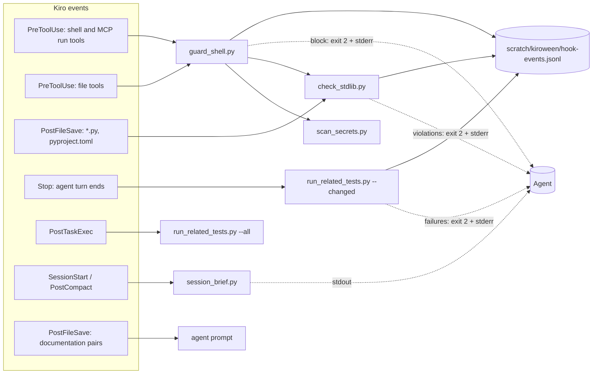

# Design Document: dev-guardrails

## Overview

Kiro runs project hooks on agent events. This feature registers eight hooks backed by small standard-library scripts in `tools/kiro/`. Two PreToolUse hooks stop dangerous tool calls before they run. Two file-save and task hooks check the stdlib rule and run tests. Two session hooks restate project state and rules. One agent-prompt hook keeps documentation pairs in step. Steering files in `.kiro/steering/` carry the standing rules, and `test/prop_support.py` sets up Hypothesis for the property tests of every spec.

## Architecture

### Hook registrations (`.kiro/hooks/*.json`)

| Id | Trigger | Matcher | Action | Timeout |
| --- | --- | --- | --- | --- |
| `shell-guard` | PreToolUse | `shell\|execute_pwsh\|execute_bash\|execute_cmd\|executePwsh\|executeBash\|control_pwsh_process\|run_with_proxy` | `python -X utf8 tools/kiro/guard_shell.py` | 60 s |
| `file-guard` | PreToolUse | `read\|write\|append\|replace\|delete_file\|deleteFile\|relocate\|edit_file\|create_file` | `python -X utf8 tools/kiro/guard_shell.py` | 30 s |
| `stdlib-only` | PostFileSave | `\.py$\|pyproject\.toml$` | `python -X utf8 tools/kiro/check_stdlib.py` | 30 s |
| `related-tests` | Stop | none | `python -X utf8 tools/kiro/run_related_tests.py --changed` | 150 s |
| `task-verify` | PostTaskExec | none | `python -X utf8 tools/kiro/run_related_tests.py --all` | 600 s |
| `docs-pair` | PostFileSave | README, QUICKSTART and `docs/operations` files | agent prompt | n/a |
| `session-brief` | SessionStart | none | `python -X utf8 tools/kiro/session_brief.py` | 30 s |
| `session-brief-after-compaction` | PostCompact | none | same as `session-brief` | 30 s |

Matchers are regular expressions that Kiro matches against tool ids without anchors, so `read` covers `read_file`, `read_code` and `fs_read`. MCP tools have ids such as `mcp_net_proxy_tool_run_with_proxy`, which `run_with_proxy` matches. Hook commands run in the project root and need `python` (3.8 or newer) on `PATH`.

## Components and Interfaces

### `_hookio.py`

- `read_event(stream)` returns the event object or `{}` for empty, non-JSON or non-object input.
- `event_paths(event)` collects strings under path-like keys (`path`, `file_path`, `targetFile`, `sourcePath`, ...) at any depth, in order, without duplicates.
- `repo_relative(path, cwd)` returns a POSIX path relative to the repository root, or `None` outside it.
- `record(hook, decision, rule, detail)` appends one JSON line to the event log and never raises.

### `guard_shell.py`

`evaluate(event, scanner) -> Decision(action, rule, message)`:

1. If `tool_input.command` is a string, or `tool_input.argv` is a list of strings, judge it as a command line.
2. Otherwise judge the paths in `tool_input`: the console configuration is blocked for every tool (`console-config`); for write tools the first path goes through the stdlib rule (`stdlib-only`).

Command lines are split into simple commands outside quotes. Each simple command is tokenized with `shlex.split(posix=False)` so Windows paths keep their backslashes. `segment_rule` applies the rules in order (`.git/config` access, console configuration, `gh` token commands including wrapped invocations, `git` remote URL commands including verbose short-option clusters, force pushes) and then recurses, at most three levels deep, into command lines handed to another shell and into `$( )` and backtick substitutions. A second pass runs the secret scan for `git commit` and `git push`; untracked files selected by a `git add` wildcard are matched conservatively before the commit.

`git_invocation(parts)` finds the first `git` word, skips global options (`-C dir` is remembered as the repository directory) and returns the subcommand and its arguments.

The stdlib rule computes the text the write would leave: `text` for a write, the current file plus a newline and `text` for an append, and the current file with `oldStr` replaced once (or everywhere with `replace_all`) for a replace. Unknown outcomes are allowed.

Rules and their names: `remote-url`, `gh-token`, `force-push`, `console-config`, `secret-scan`, `stdlib-only`.

### `scan_secrets.py`

- `PATTERNS`: `github-token` (`gh[pousr]_` and 36 or more alphanumerics), `github-fine-grained-token` (`github_pat_`), `aws-access-key-id` (`AKIA` or `ASIA` and 16 characters), `private-key` (`-----BEGIN ... PRIVATE KEY-----`), `ssh-password` (non-empty `"ssh_pass"` value), `url-credentials` (`scheme://<user>:<password>@<host>`).
- `scan_line` skips lines with the allow marker, applies the patterns, and finds Denylist entries with a case-insensitive search on the original text so that match positions stay exact.
- `scan_diff` follows hunk headers and reports only added lines, with new-file line numbers. `commit:<sha>` lines from `git log --format=commit:%H` set the source.
- `scan_staged`, `scan_worktree`, `untracked_files`, `scan_untracked`, `scan_unpushed` (`HEAD --branches --tags --not --remotes`, messages included). `scan_file` does not follow symbolic links.
- `mask(value)` shows four characters for values longer than eight characters and one character otherwise, plus the length.

### `check_stdlib.py`

`is_runtime(rel)`, `runtime_files()`, `imported_modules(tree)` (skips imports under a `try` that handles `ImportError`), `check_source(source, rel, file_dir, report_syntax_errors=True)`, `check_pyproject()`, `check_paths(rels)`. Standard modules come from `sys.stdlib_module_names`, or a Python 3.8 baseline `FALLBACK_STDLIB` where that attribute is unavailable; `graphlib`, `zoneinfo` and `tomllib` therefore require an optional import. The fallback TOML parser reads `dependencies` only from the `[project]` table.

### `run_related_tests.py`

- `related_modules(rels)`: a test module maps to itself; a source module maps to the test modules that mention its name, ranked by the number of mentions, with `test_<stem>` first; at most four.
- `run_changed(state_path)`: changed files are `git diff --name-only HEAD` plus untracked files. The fingerprint is a SHA-256 over the names and contents of the changed Python files and the chosen test modules. A run is skipped when the fingerprint equals the one stored in `scratch/kiroween/related-tests-state.json`.
- `run_modules(modules, budget=100)` and `run_suite(budget=560)` run `python -X utf8 -m unittest discover -s test [-p module]` with a temporary `NET_PROXY_CONFIG`.

### `session_brief.py`, `redacted_config.py`

`brief()` builds the text from `git branch --show-current`, the short `HEAD` hash from `git rev-parse`, `git status --porcelain`, the two version strings and two presence checks. It never includes the commit subject and calls no git command that prints URLs. `redacted_config.py` loads the configuration through `sdk.config.load_config` and prints `public_data` with `node_public_state` applied to each node.

### `test/prop_support.py`

Imports Hypothesis or raises `unittest.SkipTest` with the install command. Registers the `ci` (100 examples) and `dev` (50 examples) profiles with `deadline=None` and loads one of them.

## Data Models

- `Decision(action: "allow" | "block", rule: str, message: str)`.
- `Finding(kind: str, source: str, line: int, preview: str)`; `source` is a path, `path@sha12`, `command line` or `commit <sha12> message`.
- Event log line: `{"time": ISO 8601, "hook": str, "decision": "block" | "flag" | "run" | "pass" | "fail", "rule": str, "detail": str (at most 200 characters)}`.
- Related-tests state: `{"fingerprint": hex, "modules": [str], "passed": bool, "time": ISO 8601}`.

## Correctness Properties

*A property is a statement that must hold for every valid input. Each property below is checked by a Hypothesis test with at least 100 examples in CI.*

### Property P11: Embedded credentials are found and never shown

*For any* credential of a supported kind placed at line *n* of arbitrary text (any code points except surrogates and line breaks, without the allow marker), the Scanner reports a finding of that kind at line *n*; every preview matches `^.{1,4}\.\.\. \(\d+ chars\)$`; and the formatted report does not contain the credential. *For any* Denylist entry written in any mix of upper and lower case, exactly one `private-denylist` finding is reported, and its preview starts with the entry's first characters. *For any* unified diff hunk, a credential is reported only when it is on an added line, with its new-file line number.

**Validates: Requirements 3.4, 3.5, 3.1** (test: `test/test_prop_secrets.py`)

### Property P12: Every simple command is judged

*For any* sequence of allowed commands with one blocked command inserted at any position, joined by any of `;`, `&&`, `||`, `|`, `&` and newline, the Shell guard blocks with the blocked command's rule. *For any* sequence of allowed commands alone, it allows. *For any* blocked command that appears only inside a double-quoted argument of `echo`, it allows.

**Validates: Requirements 1.4, 1.5** (test: `test/test_prop_guard.py`)

## Error Handling

- Malformed events, unknown tools and missing fields: allow (Requirement 9.1).
- Any exception inside `evaluate`: allow, with a warning on stderr (Requirement 9.2).
- Git failures during a scan: allow, with "secret scan skipped" on stderr (Requirement 3.7).
- Unreadable files, binary files, symbolic links and files over 2 MB are not scanned. Git output is capped at 32 MB.
- Test runs that exceed their budget report a timeout with the end of their output.

## Decisions

1. **Block instead of rewrite.** The plan allowed rewriting `git remote -v` into `git remote` with `hookSpecificOutput.updatedInput`. Rewriting needs Kiro IDE 1.4.236 or later; on an older build the original command would run and print the token. Blocking with exit code 2 and the reason on stderr works on every v2-hook build. Measurements on Kiro IDE 1.1.14 for Windows found that exit code 2 with stderr blocks the call before the approval card and passes the reason to the agent, while a `permissionDecision: "deny"` on stdout with exit code 0 lets the tool run ([Kiro IDE hook payload, empirical reference](https://awslabs.github.io/aidlc-workflows/reference/kiro-ide-hook-payload/)).
2. **Related tests at the end of a turn, not on every save.** Kiro fires PostFileSave for every agent edit. A 10 to 100 second test run per edit would multiply turn time, and test-first work fails on purpose between edits. One run per turn, skipped when nothing changed, gives the same signal once.
3. **Stdlib check before and after writes.** The File guard stops an agent write before the file changes. The PostFileSave hook also covers edits that the maintainer makes in the editor, which no PreToolUse hook sees.
4. **Guards on read tools.** A blocked read keeps SSH passwords out of the transcript; `redacted_config.py` gives the agent what it legitimately needs.
5. **Fail open.** A guard bug must not stop all work. As a second line, the release procedure runs `scan_secrets.py --unpushed` by hand before anything is pushed.

## Testing Strategy

- Unit tests: `test/test_kiro_tools.py` covers each rule with allowed and blocked examples, command wrappers and wildcard path selection, the hook process exit codes, detached-HEAD and symbolic-link scanning, the diff parser, the Python 3.8 stdlib fallback, related-test mapping and skipping, the URL-safe session brief and the redacted configuration.
- Property tests: P11 and P12 above.
- Live check after registering the hooks: in a new Kiro session, use a harmless File-guard probe that attempts to create a temporary runtime file with a third-party import, and confirm that the write is blocked before the file exists. Do not probe by running a command that can display a remote URL, `.git/config`, a token or the console configuration. Until that Kiro session is run, report only that stdin payload simulations passed.
