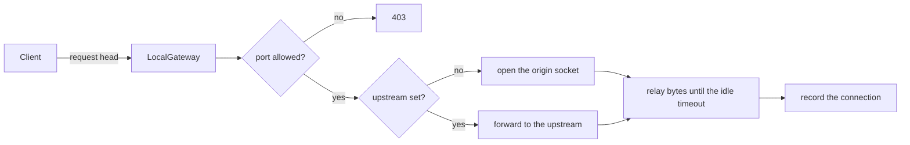

# Design Document: local-gateway

## Overview

`web/local_gateway.py` is a small HTTP proxy that ships with the tool. It listens on the loopback interface, forwards HTTP requests and CONNECT tunnels, and keeps a short memory of the connections it handled.

The class `LocalGateway` can run inside the console process or in a command of its own. The console uses the in-process form; the command line uses the same class.

## Flow



## Interfaces

```python
class LocalGateway:
    def __init__(self, host="127.0.0.1", port=0, upstream=None, allowed_ports=(80, 443),
                 max_tunnels=64, max_header_bytes=16384, connect_timeout=10.0,
                 idle_timeout=60.0, record_limit=200): ...

    def start(self) -> int:        # the port it listens on
    def stop(self) -> None
    def records(self) -> list      # the recent connections, newest first
    def config_record(self) -> dict
```

`upstream` is `None` or a `host:port` string. `allowed_ports` holds the destination ports the gateway may reach.

## The server

The server is a `socketserver.ThreadingTCPServer` with a handler that hands the connection to the gateway. It binds `127.0.0.1` only, so the gateway is never reachable from another machine.

`start()` binds the socket, starts the serving thread and returns the port. `stop()` stops the server and closes the listening socket. A start that is asked twice returns the running port.

## Handling one connection

1. Read the request head, at most 16 KiB, up to the empty line. A larger head is answered with 431 and the connection is closed.
2. Parse the request line.
3. `CONNECT host:port`: the destination must be allowed. The gateway opens the origin socket (or the upstream), answers `HTTP/1.1 200 Connection established` and relays bytes.
4. An absolute request such as `GET http://host/path HTTP/1.1`: the gateway connects to the origin, sends the request with the path in its origin form and relays the answer.
5. Anything else is answered with 400, because the gateway is a proxy and not a web server.

The destination port defaults to 443 for a CONNECT and to 80 for an absolute request, unless the URL names a port.

## Limits

| Limit | Value | Behaviour |
| --- | --- | --- |
| Tunnels | 64 | HTTP 503 when the gateway already holds that many |
| Request head | 16 KiB | HTTP 431 |
| Connect | 10 s | The socket is closed and the failure is recorded |
| Idle | 60 s | The connection is closed |

The tunnel counter is taken before the origin socket is opened and released when the connection ends, in every path.

## The upstream

When an upstream is configured, the gateway does not open the origin socket itself. It opens a connection to the upstream and sends the original request head, so the upstream performs the second hop. A failure to reach the upstream is answered with 502 and is recorded.

## The records

Every connection produces one record:

```python
{"time": "2026-11-26T12:00:00+0800", "method": "CONNECT", "host": "example.com", "port": 443,
 "outcome": "established", "bytes_to_target": 0, "bytes_to_client": 0, "seconds": 0.4}
```

The outcome is one of `established`, `refused`, `forbidden`, `failed` or `closed`. The record never holds the request or the response body, and it never holds a credential.

The gateway keeps the newest `record_limit` records in memory. The memory is gone when the gateway stops.

## The configuration record

```python
{"id": "local-gateway", "name": "本机观测网关", "host": "127.0.0.1", "port": port,
 "protocol": "http", "kind": "local", "description": "随工具提供的本机观测网关"}
```

The console can add this record to the gateway list. A remote node must not be bound to it, because a remote node cannot reach the loopback interface of the control machine; the shared diagnostics warn about exactly that.

## The command line

```text
python -m web.local_gateway --port 18899 --upstream HOST:PORT --allow-port N
```

`--allow-port` may be given several times. The command prints the address it listens on and stops on an interrupt.

## Correctness properties

### P10: The gateway answers every request and refuses what it must

*For any* request head, the gateway answers with an HTTP status and never raises. A request that is not a proxy request is answered with 400, and a request whose destination port is not allowed is answered with 403 without opening a connection.

**Validates: Requirements 2.1–2.3, 3.1–3.2 and 7.1**

## Error handling

- A malformed request line: 400.
- A head that is too large: 431.
- A forbidden destination port: 403.
- A destination that cannot be resolved or connected: 502.
- Too many tunnels: 503.
- A closed client: the tunnel is released and the record says `closed`.

## Testing strategy

`test/test_local_gateway.py` starts the gateway on port 0 and drives it with a local origin server: a CONNECT tunnel, an absolute request, a forbidden port, a plain request, the record list and the configuration record.

`test/test_prop_local_gateway.py` implements P10 with generated request heads against the running gateway.

No test reaches the internet: every origin is a local server on port 0.
