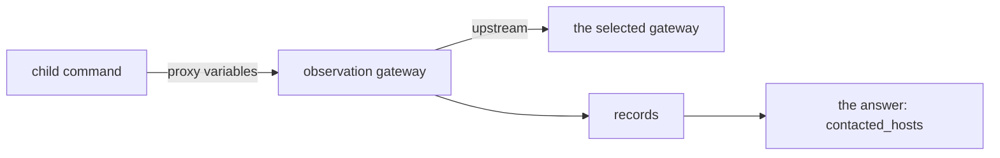

# Design Document: mcp-inspect

## Overview

The inspect mode reuses the local observation gateway of Task 8. The tool starts a gateway whose upstream is the selected proxy, points the child at the gateway, runs the command and reads the gateway's records.

## Flow



## Behaviour

`run_with_proxy` gains one argument:

| Argument | Type | Meaning |
| --- | --- | --- |
| `inspect` | Boolean | Observe the command instead of running it straight through the gateway |

When `inspect` is true:

1. `LocalGateway(port=0, upstream="host:port", allowed_ports=(80, 443))` is started.
2. The child's proxy variables point at `127.0.0.1:<gateway port>`.
3. The command runs as usual, with the same limits.
4. The gateway is stopped, and its records are read into `contacted_hosts`.

The records are read before the gateway is stopped, because stopping it clears the memory. The gateway is stopped in a `finally` block, so a timeout, a cancellation or an error still closes it.

## The contacted hosts

```python
hosts = []
for record in gateway.records_list():
    entry = {"host": record["host"], "port": record["port"]}
    if entry not in hosts:
        hosts.append(entry)
```

Only the records of connections that were established count; a refused or forbidden destination is not a host the command reached. The order is the order of the first contact.

The entry holds a host and a port and nothing else: no path, no header, no body.

## The selected gateway stays in the path

The observation gateway's upstream is the selected gateway, so the traffic path is unchanged:

```text
child -> observation gateway -> selected gateway -> origin
```

The child sees a proxy on the loopback interface, which is the only kind of proxy the observation gateway offers.

## Error handling

- The observation gateway cannot start: the tool answers with the error type and no host list.
- The command fails: the contacted hosts are still reported, because they explain the failure.
- The command is stopped: the gateway is stopped and the answer reports the timeout.

## Testing strategy

`test/test_mcp_inspect.py` starts a local recording proxy, points the configuration at it, and runs a command that asks for a URL through the proxy variables. The test asserts that the recording proxy received the request, that the contacted hosts name the requested host, and that no gateway is left listening.

The test never reaches the internet: the recording proxy is a local server on port 0.
