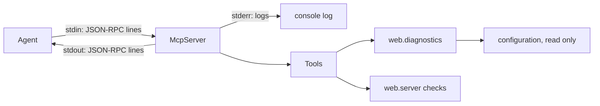

# Design Document: mcp-server

## Overview

`net_proxy_mcp.py` is a standalone standard-library program. It reads JSON-RPC messages from standard input, answers them on standard output and keeps everything else on standard error. The tools reuse the console's own diagnostics, so the console and the agent report the same facts.



## Program layout

| Part | Purpose |
| --- | --- |
| `Protocol constants` | The supported versions, the meta keys and the error codes |
| `McpError` | An error with a JSON-RPC code, a message and optional data |
| `ToolRegistry` | The tool descriptions and their implementations |
| `McpServer` | The message loop, the worker pool and the writer |
| `main` | The argument parsing and the server start |

## Protocol

### Versions

```python
PROTOCOL_VERSION = "2026-07-28"
LEGACY_VERSIONS = ("2025-11-25", "2025-06-18", "2025-03-26", "2024-11-05")
SUPPORTED_VERSIONS = (PROTOCOL_VERSION,) + LEGACY_VERSIONS
META_VERSION = "io.modelcontextprotocol/protocolVersion"
META_CAPABILITIES = "io.modelcontextprotocol/clientCapabilities"
META_CLIENT_INFO = "io.modelcontextprotocol/clientInfo"
META_SERVER_INFO = "io.modelcontextprotocol/serverInfo"
```

### Error codes

| Code | Meaning |
| --- | --- |
| `-32700` | The line is not valid JSON |
| `-32600` | The message is not a JSON-RPC request |
| `-32601` | The method is unknown |
| `-32602` | The parameters are invalid or a required meta field is missing |
| `-32603` | An unexpected error; only its type is reported |
| `-32022` | The protocol version is not supported |
| `-32800` | The request was cancelled |

### Version resolution

`request_version(params)` reads the version from `params._meta[META_VERSION]`, and falls back to the legacy field `params.protocolVersion`.

`validate(params, method)` then:

- with no version at all: a handshake method (`initialize`, `server/discover`) fails with `-32602`; any other method is accepted, because a client continues with the version it already negotiated;
- with a version that is not supported: fails with `-32022` and the data `{"supported": [...], "requested": "..."}`;
- with the current protocol version: `params._meta[META_CAPABILITIES]` must be present, otherwise `-32602`.

### Methods

| Method | Answer |
| --- | --- |
| `initialize` | The negotiated version, the capabilities and the server information |
| `server/discover` | `resultType: "complete"`, `supportedVersions`, `capabilities`, `_meta[META_SERVER_INFO]`, `instructions` |
| `tools/list` | The tool descriptions |
| `tools/call` | `content`, `structuredContent`, `isError` |
| `ping` | An empty result |
| `notifications/cancelled` | Nothing |

### Message loop

The loop reads one line at a time. A line that is not JSON answers with `-32700` and the identifier `null`. A message without a method is ignored. A message without an identifier is a notification: the server acts on it and answers nothing.

Every request is submitted to a `ThreadPoolExecutor` with four workers, and the identifier is remembered together with its future. The answers are written under a lock, so two workers cannot interleave a line.

After the start, `sys.stdout` is replaced by a writer that sends everything to standard error, and the protocol keeps its own writer on the original standard output. A stray `print` in any library can therefore no longer corrupt the protocol stream.

### Cancellation

`notifications/cancelled` names a request identifier. The server marks it cancelled and cancels the future when it has not started. When the worker finishes, it checks the cancelled set and answers with `-32800` instead of the result, so the request still receives exactly one response.

## Tools

| Tool | Arguments | Answer |
| --- | --- | --- |
| `list_gateways` | none | The configured gateways, redacted |
| `check_gateway` | `gateway_id` or `address`, `target_url`, `timeout` | The probe result |
| `check_gateway_targets` | `gateway_id` | One result per configured target |
| `list_nodes` | none | The node summaries |
| `test_node` | `node_id`, `target_url` | The ordinary and the explicit proxy request |

`check_gateway` accepts either a saved identifier or an `host:port` address. Its default target is `https://www.google.com/` and its timeout is capped at 60 seconds.

`test_node` reuses `web.server.check_node_requests`, which runs one ordinary request and one explicit proxy request and reports both. It refuses an unknown node with an error result rather than an exception.

Every answer passes through `web.server.public_data`, so no password, token or node baseline can leave the server.

## Data models

- Tool answer: `{"content": [{"type": "text", "text": "..."}], "structuredContent": {...}, "isError": false}`.
- Tool description: `{"name", "description", "inputSchema", "annotations": {"readOnlyHint": true}}`.
- Error: `{"code": int, "message": str, "data": {...}}`.

## Correctness properties

### P8: Every answer is well-formed and every request is answered once

*For any* sequence of valid JSON-RPC messages, the server answers with one line per message that is a JSON-RPC object, answers every message that carries an identifier exactly once with that identifier, and answers a message without an identifier not at all.

**Validates: Requirements 2.1, 2.2, 2.5, 6.3 and 7.1**

## Error handling

- Invalid JSON: `-32700`.
- Unknown method: `-32601`.
- Unknown tool or invalid arguments: `-32602`, as a tool error answer where the tool was known.
- An unexpected error inside a tool: the tool answer carries `isError: true` and the error type; the stack trace goes to standard error.
- An unexpected error in the server itself: `-32603` with the error type only.

## Testing strategy

`test/test_mcp_server.py` drives the server over a pipe with hand-written messages and covers the version negotiation, the five tools and the cancellation.

`test/test_prop_mcp.py` implements P8 with generated message sequences.

All tests use a temporary `NET_PROXY_CONFIG`, patch the network probes and never contact a real destination.

## Decisions

1. **Read-only tools only.** An agent that can switch a node could take the operator's environment apart. The console stays the place where changes happen.
2. **The console's own diagnostics.** Reusing `web.diagnostics` and `web.server` keeps one truth about a gateway, so the agent cannot report a different state than the operator sees.
3. **Redact every answer.** `public_data` is applied to the whole answer, not to selected fields, so a new field cannot leak by omission.
4. **Cancel with an error, not with silence.** A request that received no answer at all leaves the client waiting; the `-32800` error closes the exchange and still satisfies "one answer per request".
5. **Redirect `sys.stdout` after startup.** The protocol writer keeps the original stream; everything else is diverted, which protects the stream from library output.
