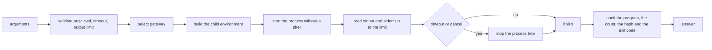

# Design Document: proxy-execution

## Overview

The `run_with_proxy` tool reuses the proxy environment of `sdk.config.proxy_environment` and starts one process with it. The tool lives in `net_proxy_mcp.py`, next to the other tools, and shares the configuration and the gateway selection with them.

## Flow



## Validation

| Argument | Rule |
| --- | --- |
| `argv` | A list of one to sixty-four strings |
| `argv[i]` | Not empty, no NUL, at most 4096 characters |
| `gateway_id` or `address` | Selects the gateway, exactly as `check_gateway` does |
| `cwd` | Inside the directory the server was started in |
| `timeout` | A number of seconds, at most 600, default 120 |
| `max_output_bytes` | A number of bytes, at most 262144, default 65536 |

The program is resolved with `shutil.which`. On Windows a program whose name ends in `.bat` or `.cmd` is refused, because such a program needs a command interpreter and would reintroduce the shell the tool avoids.

## The working directory

`ToolRegistry` remembers the directory the server was started in. A given `cwd` is resolved against it, and the result must be inside it. The check compares the resolved path, so `..` cannot escape. Symbolic links are resolved before the comparison.

## The child environment

The environment is a copy of the server's environment with the proxy variables of the selected gateway added. The server's own environment is never modified: the copy is handed to the child, and a test compares the environment before and after a run.

The proxy variables are the ones of `sdk.config.proxy_environment`: `HTTP_PROXY`, `HTTPS_PROXY`, `ALL_PROXY` and `NO_PROXY` in both cases.

## Running the command

```python
process = subprocess.Popen(argv, cwd=directory, env=environment, shell=False,
                           stdout=subprocess.PIPE, stderr=subprocess.PIPE,
                           start_new_session=True, creationflags=...)
```

On POSIX the child gets a new session, so it leads its own process group. On Windows it gets a new process group. Either way the whole tree can be stopped:

- POSIX: `os.killpg(os.getpgid(process.pid), signal.SIGKILL)`
- Windows: `taskkill /PID <pid> /T /F`

Two reader threads collect the output and stop at the limit, so a command that writes without end cannot fill the memory of the server.

## The answer

```python
{"program": ..., "argument_count": ..., "cwd": ..., "exit_code": ...,
 "timed_out": bool, "cancelled": bool, "duration_ms": ...,
 "stdout": ..., "stderr": ..., "stdout_truncated": bool, "stderr_truncated": bool,
 "gateway": {"id": ..., "host": ..., "port": ...}, "proxy_url": ...}
```

The output of the command is returned to the agent, because that is what the agent asked for. It is not written to the audit log.

## The audit record

The record holds the program name, the number of arguments, the argument hash and the exit code:

```python
write_audit_log("mcp_run_with_proxy", node_id="-", status="success" if code == 0 else "failed",
                details="program={} arguments={} hash={} exit={}".format(...))
```

The hash is a SHA-256 over the argument list, so two runs of the same command can be told apart without storing the arguments.

## Correctness properties

### P9: The proxy reaches the child and only the child

*For any* valid gateway, the child process sees the proxy variables of that gateway in both cases, and the environment of the server process before and after the run is identical.

**Validates: Requirements 2.1–2.3 and 6.1**

## Error handling

- An invalid argument: the tool refuses with `-32602`.
- A program that is not on the search path: the tool refuses with `-32602`.
- A timeout or a cancellation: the process tree is stopped and the answer reports it.
- A command that cannot be started: the answer reports the error type, and the audit record is still written.

## Testing strategy

`test/test_run_with_proxy.py` covers the validation, the child environment, the working directory, the timeout with a process tree, the output limit and the audit record.

`test/test_prop_proxy_execution.py` implements P9 with a generated gateway and a generated argument list.

Every test runs a harmless local command, such as the Python interpreter that prints its environment, and never reaches the network.
