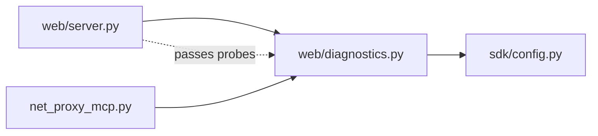

# Design Document: shared-diagnostics

## Overview

`web/diagnostics.py` holds the aggregation that the console and the MCP server share. It imports only from `sdk.config`, so it never has to import the console itself, and it receives the network probes as callables so that a caller can inject a fake and a test can stay offline.

`tools/kiro/check_release_consistency.py` reports the version placeholders of a release. It reads files and prints findings; it never changes them.

## Module layout



### `sdk.config.proxy_url(host, port)`

```python
def proxy_url(host, port):
    address = "[{}]".format(host) if ":" in host else host
    return "http://{}:{}".format(address, port)
```

`proxy_environment` uses it, and `web.server.gateway_url` uses it, so the console, the diagnostics and the CLI cannot produce different URLs.

### `web.diagnostics`

```python
def gateway_report(cfg, gateway_id=None, tcp_probe=None):
    """Return the gateway section of a status report, or None."""

def targets_report(cfg, proxy, target_probe=None, workers=7):
    """Return one result per configured diagnostic target."""

def node_summary(cfg, node, gateway_resolver=None):
    """Return the public summary of one node with its effective proxy."""

def status_report(cfg, gateway_id=None, tcp_probe=None, target_probe=None, workers=7):
    """Return the complete status report."""
```

`gateway_report` resolves the gateway with `sdk.config.resolve_gateway_info`. When the gateway is missing it returns `None`; when its protocol is not HTTP it returns a report whose `error` names the reason and whose `tcp_ok` stays false.

`targets_report` submits one probe per configured target to a `ThreadPoolExecutor` and collects the results in submission order, so the report lists the targets in configuration order.

`status_report` combines the three: it probes the gateway's TCP port, then the targets through that gateway, and derives `online` and `path_verified` from the target results.

`node_summary` describes the node without any credential and adds:

- `effective_proxy`: the proxy URL of the bound gateway, or null;
- `gateway`: the bound gateway's identity, or null;
- `warnings`: a list of human-readable notices.

The notices are:

| Situation | Notice |
| --- | --- |
| A remote node is bound to a loopback gateway | The node cannot reach the control machine's loopback interface |
| A remote node has no binding | A binding is required before enabling the proxy |
| The bound gateway no longer exists | The binding must be chosen again |

A local node is never warned about a loopback gateway, because a local node runs on the control machine.

### Console integration

`handle_api_status` becomes a thin wrapper:

```python
report = diagnostics.status_report(cfg, gid, tcp_probe=check_tcp_port, target_probe=check_http_target)
if report["gateway"] is None:
    self.send_json(dict(report, error="未找到网关，请先在首页保存 HTTP 代理网关。"), 404 if gid else 200)
    return
self.send_json(report)
```

The response shape, the status codes and the target order are unchanged, so the existing console tests and the browser checks keep working.

### Release consistency

`tools/kiro/check_release_consistency.py` reads:

| Source | Pattern |
| --- | --- |
| `sdk/config.py` | `VERSION = "x.y.z"` |
| `pyproject.toml` | `version = "x.y.z"` |
| `config.example.json` | `"version": "x.y.z"` |
| `README.md` | the release download links and the download heading |
| `README_EN.md` | the same |
| `CHANGELOG.md` | the newest `## [x.y.z]` heading |

It prints one line per source with the value it found, then one line per mismatch. It also compares the `no_proxy` value of `config.example.json` with `sdk.config.NO_PROXY`. It exits with code 1 when anything disagrees.

The tool reports the current state honestly: while v1.5.0 is unreleased the newer changelog heading and the older example configuration are reported as mismatches, and the release task removes them.

## Correctness properties

The existing P1–P6 properties keep covering the request boundary. This task adds focused unit tests for the reports; the reports are deterministic given their probes, so generated input adds little beyond the type and range checks already covered.

## Error handling

- A missing gateway: `gateway: null`, no exception.
- A gateway with an unusable protocol: the reason is reported, no target is probed.
- A probe that raises: the exception reaches the caller, which already maps it to a clear error response.
- A missing or unreadable file in the release check: the tool reports it as a mismatch instead of stopping.

## Testing strategy

`test/test_shared_diagnostics.py` covers the reports with injected probes: no gateway, an unreachable gateway, a gateway with a non-HTTP protocol, the target order, the node summary warnings and the proxy URL format.

`test/test_release_consistency.py` covers the release checker against a temporary directory with consistent and inconsistent versions.

All tests use a temporary `NET_PROXY_CONFIG` and never probe a real target.
