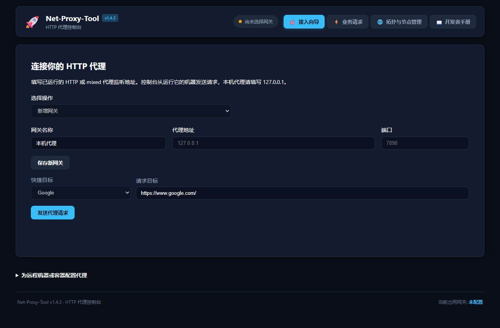

# 第一次使用

[English](QUICKSTART_EN.md) · [下载](README.md#下载并打开控制台) · [排障](docs/operations.md)

准备一台能运行浏览器的电脑，以及一个你有权使用的 HTTP 或混合代理。先在代理客户端记下**监听地址和端口**。本机代理通常监听 `127.0.0.1`。其他机器访问它时，需要使用那台机器可达的地址和开放的端口。

## 1. 选择下载包

Windows 选 x64 ZIP。macOS 打开“关于本机”，Apple 芯片选 ARM64，Intel 选 x64。Linux 运行 `uname -m`，`x86_64` 选 x64，`aarch64` 选 ARM64。Linux 发布包使用 glibc；Alpine 用户可选择源码或容器方式。GitHub 的 **Source code** 压缩包需要另备 Python。 [下载列表](README.md#下载并打开控制台)

需要核对下载内容时，从同一 Release 下载 `SHA256SUMS.txt`。在下载目录运行相应命令，把结果与清单中**同名文件**的 64 位十六进制值逐字核对。命令示例使用各平台的一种架构，文件名请按实际下载包调整。

```powershell
Get-FileHash .\net-proxy-tool-windows-x64.zip -Algorithm SHA256
```

```bash
# macOS
shasum -a 256 net-proxy-tool-macos-arm64.tar.gz
# Linux
sha256sum net-proxy-tool-linux-x64.tar.gz
```

向导显示“请求失败”时，展开详情查看最后尝试的主机、TLS 和最终 HTTP。收到 302 后在下一站超时，本次访问仍是失败。可用界面的 GET 复测命令核对同一网关和原始网址。

## 2. 解压并启动

- **Windows** · 右键 ZIP → 全部解压，打开其中的 `net-proxy-tool`，双击 `Start.bat`。需要查看启动消息时，在该目录的 PowerShell 中运行 `.\Start.bat`。
- **macOS / Linux** · 解压 tar.gz，进入 `net-proxy-tool`，运行 `./net-proxy-tool`。若 macOS 提示未识别开发者，核对来源和校验和后，在“系统设置 → 隐私与安全性”查看该程序的打开选项。
- **无桌面的服务器** · 运行 `./net-proxy-tool --no-browser`，在自己的电脑上按启动器输出的 SSH 端口转发命令连接，然后用本地浏览器访问。

macOS 便携包按终端命令分发，未做 Apple Developer ID 公证。Intel 与 Apple Silicon 的 macOS 15 测试均记录了系统签名评估和带下载隔离标记的启动结果。受管理设备请遵循组织的应用准入策略。

桌面启动器会在服务就绪后打开浏览器。默认地址是 `http://127.0.0.1:8899/`。若 8899 已被其他应用占用，可运行 `.\Start.bat 8900` 或 `./net-proxy-tool 8900`。首次使用不需要管理员权限或远程节点。

## 3. 保存网关，发出第一条请求

1. 在首页填写一个可辨认的名称，如「本机代理」，以及实际主机和端口。保存后，第一个网关自动成为当前网关。
2. 在测试地址框输入允许访问的 HTTP(S) 网址，点击**发送代理请求**。展示的状态码来自这个请求。只有 TCP 端口可连接、目标网站仍失败时，页面会提示进一步检查协议或上游。

测试第二条网关时请使用新增操作。将网页上的网关和测试网址与自己的输入核对；真实请求可能先经过一次或多次 HTTP 重定向。

同一台 Windows 电脑上，网页可以通过所选网关发送请求；要让自己的程序使用代理，请用下方 CLI 或 SDK 示例启动它。远端节点需要在向导中单独保存绑定。

**成功标志** · 目标返回成功状态码后，第一次代理请求已完成。后续需要运行自己的任务时，可以选择控制台或复制页面上的命令。目标站点要求登录或触发限流时，请结合状态码判断原因。



**停止** · 关闭浏览器标签页后，服务仍会运行。在解压目录使用 `.\Start.bat --stop` 或 `./net-proxy-tool --stop`。再次启动会读取已保存的网关。

## 从新开的 SSH 终端复测

选择与节点池相同的主机、端口、账号和网址。宿主机 Docker 管理账号与容器账号可能不同。进入终端后，先运行原样请求，再单独记录最终结果：

```sh
curl https://www.google.com/
curl -sS -L --max-time 30 -o /dev/null -w 'HTTP %{http_code}  redirects=%{num_redirects}  peer=%{remote_ip}:%{remote_port}\n' https://www.google.com/
```

302 表示收到了跳转；403 表示目标拒绝本次访问。curl 退出 35 表示 TLS 握手错误。记录每次请求的结果，结合节点池的普通请求和显式代理两行对照。

## 用源码或 Python 环境运行

从源码目录执行以下命令，需要 Python 3.8 或更新版本。在 macOS / Linux 上用 `python3` 替代 `python`。从源码直接启动控制台无需安装第三方 Python 包。

```console
python launcher.py
```

若需要在任意目录使用命令，在自己的虚拟环境中安装本地项目。

```console
python -m pip install .
net-proxy-tool
```

保存网关后，让单次 curl 请求通过它。Windows 中用 `curl.exe`。

```console
with-proxy curl -L https://www.google.com/
```

在同一个 Python 环境中也可以临时设置代理。SDK 改变当前 Python 进程的环境变量，同一进程中的其他线程也会看到这些值。

```python
from urllib.request import urlopen
from sdk import ProxySession

with ProxySession():
    with urlopen("https://www.google.com/", timeout=10) as response:
        print(response.status)
```

如需在 Linux 主机或 Docker 容器里启用长期代理，请继续阅读[运维指南](docs/operations.md)。
