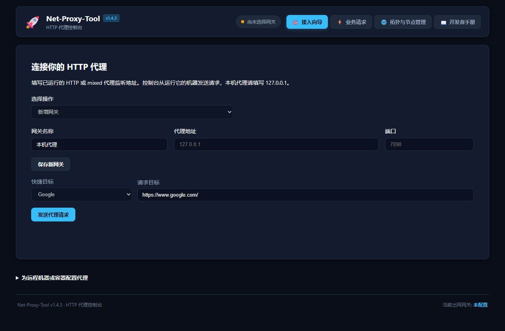

# Your first proxied request

[简体中文](QUICKSTART.md) · [Downloads](README.md#download-and-open-the-console) · [Troubleshooting](docs/operations_en.md)

Have a running HTTP or mixed-mode proxy that you are authorized to use. Find its **listening host and port** in your proxy client's settings. A proxy on this computer can usually be reached at `127.0.0.1`. Other hosts need an address and port reachable from their own network.

## 1. Select and verify an archive

Windows uses the x64 ZIP. On a Mac, check About This Mac and choose ARM64 for Apple Silicon or x64 for Intel. On Linux, check `uname -m` and choose x64 for `x86_64` or ARM64 for `aarch64`. Linux bundles use glibc. Alpine users can use source or Docker. GitHub's **Source code** archives require a separate Python installation. [Download table](README.md#download-and-open-the-console)

To verify a download, get `SHA256SUMS.txt` from the same release. Run the appropriate command in the download directory and compare the 64 hex digits with the entry for the exact filename. Substitute your archive name if the architecture differs.

```powershell
Get-FileHash .\net-proxy-tool-windows-x64.zip -Algorithm SHA256
```

```bash
# macOS
shasum -a 256 net-proxy-tool-macos-arm64.tar.gz
# Linux
sha256sum net-proxy-tool-linux-x64.tar.gz
```

If a request fails, expand the result to see the last host attempted, TLS stage and final HTTP status. A redirect followed by a timeout leaves the request incomplete. Copy the GET command to check the same gateway and original URL.

## 2. Extract and start

- **Windows** · Right-click the ZIP, choose **Extract All**, open the extracted `net-proxy-tool` folder and double-click `Start.bat`. To see startup messages, run `.\Start.bat` from PowerShell in the same folder.
- **macOS / Linux** · Extract the tar.gz, open the `net-proxy-tool` directory in a terminal and run `./net-proxy-tool`. If macOS reports an unrecognized developer, verify the source and checksum before reviewing the program's open option under System Settings → Privacy & Security.
- **Headless server** · Run `./net-proxy-tool --no-browser`. Run the SSH port-forward command printed by the launcher on your computer and open the local URL there.

The desktop launcher opens your browser once the service responds. The default URL is `http://127.0.0.1:8899/`. If another program uses port 8899, try `.\Start.bat 8900` or `./net-proxy-tool 8900`. You can complete setup as a regular user without any remote nodes.

The macOS archives are terminal distributions and are not notarized with Apple Developer ID. The macOS 15 Intel and Apple Silicon release checks record the signature assessment and a launch with a simulated download-quarantine marker. Follow your organization’s software policy on managed devices.

## 3. Add a gateway and send a request

1. On the first tab, give the gateway a recognizable name and enter its actual host and port. Save it. Your first gateway becomes active.
2. Enter an allowed HTTP(S) target in the test URL field. Click **发送代理请求** (Send proxy request). Read the resulting HTTP status. A reachable TCP port with a failed target request calls for checking the proxy protocol or upstream connection.

**Success** · A successful HTTP status from your target completes the first request. To run your next task, you can use the console or copy the displayed command. A site can require authentication or rate-limit requests, so check the returned status code.

Use the add action for a second gateway. Check the selected gateway, the requested URL and the final HTTP status after redirects. For a Windows application, start it with the CLI or use the SDK in your own Python process. Save a separate gateway binding for a remote node before switching it.



**Stop the service** by running `.\Start.bat --stop` or `./net-proxy-tool --stop` from the extracted directory. Closing the browser tab leaves the service running. Your gateway will be available at the next start.

## Recheck from a fresh SSH login

Log in to the same host, port and account shown for the node. Compare the same URL with the worker pool.

```sh
curl https://www.google.com/
curl -sS -L --max-time 30 -o /dev/null -w 'HTTP %{http_code}  redirects=%{num_redirects}  peer=%{remote_ip}:%{remote_port}\n' https://www.google.com/
```

The first command shows the initial response. The second follows redirects. An HTTP 403 indicates a refusal, while curl exit 35 identifies a TLS handshake failure.

## Run from source or a Python environment

Run the following in the source directory with Python 3.8 or newer. Use `python3` on macOS or Linux. Running from source uses the Python standard library.

```console
python launcher.py
```

To use the commands from any directory, install the local project into your virtual environment.

```console
python -m pip install .
net-proxy-tool
```

After saving a gateway, send one request through it. On Windows, use `curl.exe` for the curl executable.

```console
with-proxy curl -L https://www.google.com/
```

The same Python environment can scope proxy settings to a block. Environment variables are process-wide, so other threads can observe the settings while the block runs.

```python
from urllib.request import urlopen
from sdk import ProxySession

with ProxySession():
    with urlopen("https://www.google.com/", timeout=10) as response:
        print(response.status)
```

For persistent proxy settings on remote Linux hosts and Docker containers, continue to [Operations](docs/operations_en.md).
