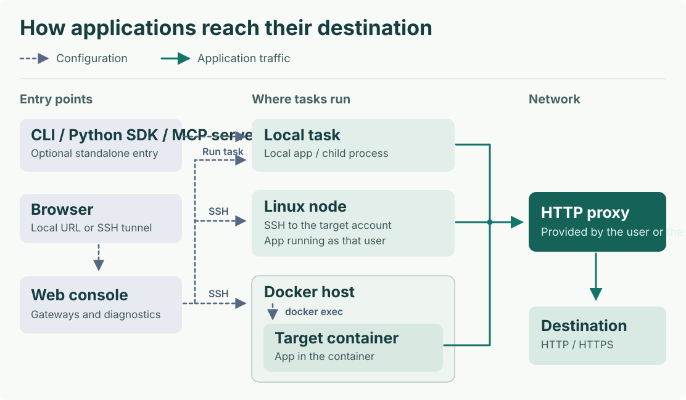
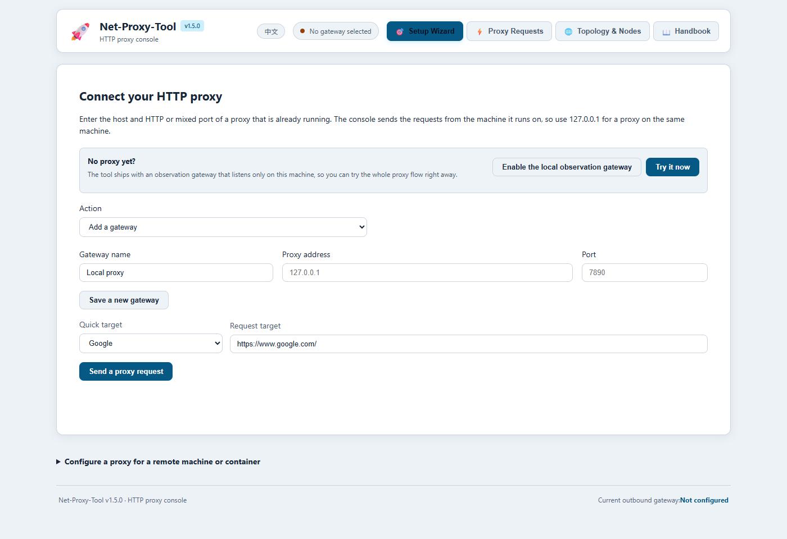

# net-proxy-tool

 · [GitHub Releases](https://github.com/xuarehere/net-proxy-tool/releases/latest)

[简体中文](README.zh-CN.md) · [Quick start](QUICKSTART_EN.md) · [Operations](docs/operations_en.md) · [Changelog](CHANGELOG.md)

Use a local Web console to route a command, a Python task or a selected remote node through an existing HTTP proxy. Test a request in the browser before choosing which workloads should use the gateway.

Gateway tests show the selected site’s final response or the host where the request stopped. When you disable a worker, the console checks its restored settings against the account’s original login environment.

## Download and open the console

| System | Download v1.5.0 | Start after extracting |
| --- | --- | --- |
| Windows | [x64 · ZIP](https://github.com/xuarehere/net-proxy-tool/releases/download/v1.5.0/net-proxy-tool-windows-x64.zip) | `Start.bat` |
| macOS | [Apple Silicon · tar.gz](https://github.com/xuarehere/net-proxy-tool/releases/download/v1.5.0/net-proxy-tool-macos-arm64.tar.gz) | `./net-proxy-tool` |
| macOS | [Intel · tar.gz](https://github.com/xuarehere/net-proxy-tool/releases/download/v1.5.0/net-proxy-tool-macos-x64.tar.gz) | `./net-proxy-tool` |
| Linux · glibc | [x86_64 · tar.gz](https://github.com/xuarehere/net-proxy-tool/releases/download/v1.5.0/net-proxy-tool-linux-x64.tar.gz) | `./net-proxy-tool` |
| Linux · glibc | [ARM64 · tar.gz](https://github.com/xuarehere/net-proxy-tool/releases/download/v1.5.0/net-proxy-tool-linux-arm64.tar.gz) | `./net-proxy-tool` |

The release checks run the downloaded packages on Windows x64, macOS 15 (Intel and Apple Silicon), Ubuntu 24.04 (x64 and ARM64), plus clean Ubuntu 22.04/24.04 and Debian 12 x64 containers. The runtime is also checked on Python 3.8 and 3.13. For Alpine/musl, use [Docker Compose](docs/operations_en.md).

1. **Extract the entire archive** and open its `net-proxy-tool` folder. On Windows, double-click `Start.bat`. On macOS or Linux, run `./net-proxy-tool` in that folder. The release archives include Python.
2. In the browser, enter the **host and HTTP or mixed port** of a running proxy, then save it. Use `127.0.0.1` when the proxy client runs on the same computer. Read the port from that client’s settings.
3. Click **Send a proxy request**. A successful HTTP status from your target completes the first request.

For checksums, source installation, shutdown and port conflicts, see the [quick start](QUICKSTART_EN.md). [Release assets and checksums](https://github.com/xuarehere/net-proxy-tool/releases/tag/v1.5.0)

Choose Google, Claude, ChatGPT, YouTube, Gemini or a custom URL in the worker pool. The two probes show the node, selected target, initial response, final HTTP status and observed peer.

## No proxy yet? Try it in one click

The tool ships a **local observation gateway**: a small proxy that listens on the loopback interface only, forwards your request and records which hosts it saw. On the first-run screen, choose **Enable the local observation gateway** to save it as a gateway, or **Try it now** to start it and send one request through it at the same time. You can keep it as your gateway, or delete it later.

The observation gateway reaches only ports 80 and 443, holds at most 64 tunnels and never listens for another machine.

## For coding agents

`net-proxy-tool-mcp` serves the same diagnostics over the Model Context Protocol, so an agent can read your gateways, test one of them, list your nodes and run one command through the proxy. It is read-only: it never writes the configuration and never switches a node. See [the Kiro and agent guide](docs/kiro_en.md).

## Where requests travel

The browser connects locally or through an SSH tunnel. Dashed lines show the console starting a local task, configuring a Linux account over SSH or using `docker exec` on a host to reach its container. The CLI, the SDK and the MCP server can run local tasks independently. Solid lines follow each application’s request through the user’s HTTP proxy to its destination. [Open the full-size SVG to zoom on mobile](docs/assets/architecture.en.svg)

## Choose where the proxy applies

| Use case | Entry point | Scope |
| --- | --- | --- |
| Run Git, curl or pip through a proxy once | CLI | The child process and its descendants |
| Use a proxy in part of a Python program | `with ProxySession():` | Process-wide proxy variables, restored when the block exits |
| Let an agent check your proxy state | MCP server | Read-only diagnostics and one observed command |
| Manage Linux hosts and containers | Node management in the Web console | The selected remote account, tool configuration or container until changed |

## Documentation

- [Quick start](QUICKSTART_EN.md) covers the first proxy request, running from source and the Python SDK.
- [Operations and troubleshooting](docs/operations_en.md) covers settings, upgrades, SSH, containers and logs.
- [Kiro and agent guide](docs/kiro_en.md) describes the specifications, the hooks, the steering files and the MCP server.
- [Security policy](SECURITY.md) describes the console’s permissions, credential handling and vulnerability reporting.
- [Contributing](CONTRIBUTING.md) explains how to test changes and regenerate the architecture diagrams.

[MIT license](LICENSE)
