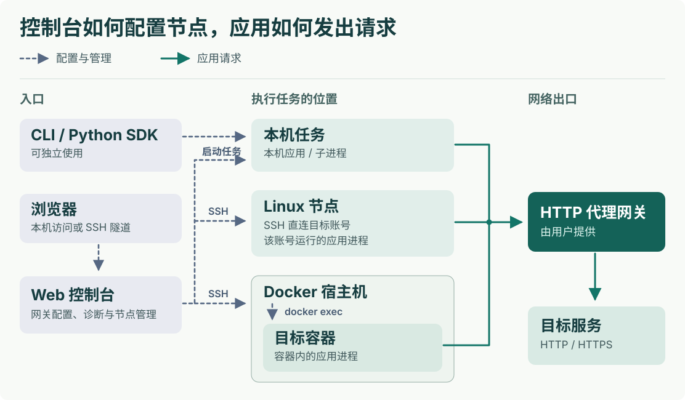
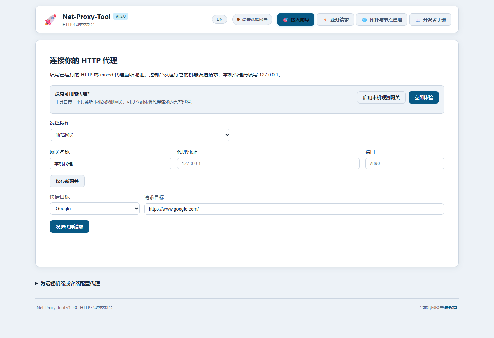

# net-proxy-tool

 · [GitHub Releases](https://github.com/xuarehere/net-proxy-tool/releases/latest)

[English](README.md) · [快速上手](QUICKSTART.md) · [运维与排障](docs/operations.md) · [版本记录](CHANGELOG.md)

通过本机 Web 控制台，把一个命令、Python 任务或指定的远程节点接到你已有的 HTTP 代理。可以先在浏览器里验证代理能否访问目标网站，再决定哪些任务使用它。

网关测试显示所选网站的最终响应；中途跳转或 TLS 超时会标出失败站点。节点关闭后，控制台对照开启前的账号环境核验恢复结果。

## 下载并打开控制台

| 系统 | 下载 v1.5.0 | 解压后启动 |
| --- | --- | --- |
| Windows | [x64 · ZIP](https://github.com/xuarehere/net-proxy-tool/releases/download/v1.5.0/net-proxy-tool-windows-x64.zip) | `Start.bat` |
| macOS | [Apple Silicon · tar.gz](https://github.com/xuarehere/net-proxy-tool/releases/download/v1.5.0/net-proxy-tool-macos-arm64.tar.gz) | `./net-proxy-tool` |
| macOS | [Intel · tar.gz](https://github.com/xuarehere/net-proxy-tool/releases/download/v1.5.0/net-proxy-tool-macos-x64.tar.gz) | `./net-proxy-tool` |
| Linux · glibc | [x86_64 · tar.gz](https://github.com/xuarehere/net-proxy-tool/releases/download/v1.5.0/net-proxy-tool-linux-x64.tar.gz) | `./net-proxy-tool` |
| Linux · glibc | [ARM64 · tar.gz](https://github.com/xuarehere/net-proxy-tool/releases/download/v1.5.0/net-proxy-tool-linux-arm64.tar.gz) | `./net-proxy-tool` |

发行测试运行于 Windows x64、macOS 15（Intel 和 Apple Silicon）、Ubuntu 24.04（x64 和 ARM64），并覆盖 Ubuntu 22.04、24.04 与 Debian 12 的干净 x64 容器；运行时同时在 Python 3.8 与 3.13 上验证。Alpine/musl 环境可使用 [Docker Compose](docs/operations.md)。

1. **完整解压**下载包，进入其中的 `net-proxy-tool` 目录。Windows 双击 `Start.bat`，macOS 或 Linux 在该目录运行 `./net-proxy-tool`。发布包自带 Python。
2. 浏览器打开本地控制台。填写已有代理的**主机和 HTTP 或混合端口**，然后保存。代理客户端若运行在同一台电脑上，主机通常填 `127.0.0.1`；端口请从客户端设置中读取。
3. 点击**发送代理请求**。检查实际使用的网关、跳转后的网址和最终状态码。要在远端执行同样的请求，请到节点池选择节点并保存它的网关绑定。

只有源码或已有 Python？源码启动、校验和、停止服务和端口冲突的处理见[快速上手](QUICKSTART.md)。[所有发布包与校验文件](https://github.com/xuarehere/net-proxy-tool/releases/tag/v1.5.0)

在**拓扑与节点管理 → 目标业务节点池**选择 Google、Claude、ChatGPT、YouTube、Gemini 或自己的网址。核对节点和账号，再查看首跳、最终 HTTP 状态和实际对端。Google 有时先返回 302；页面会继续跟随跳转。

## 还没有代理？一键体验

工具自带**本机观测网关**：一个只监听回环地址的小型代理，它会转发请求并记录访问过哪些主机。首次打开页面时，点击**启用本机观测网关**把它保存为网关，或点击**立即体验**在启动它的同时发送一次代理请求。它可以一直作为你的网关使用，也可以随时删除。

观测网关只访问 80 和 443 端口，最多同时保持 64 条隧道，并且永远不会对其他机器开放。

## 面向编程代理

`net-proxy-tool-mcp` 通过 Model Context Protocol 提供与控制台一致的诊断能力：代理可以读取你的网关、测试其中一个网关、列出节点，并通过代理运行一条命令。它是只读的，不会写入配置，也不会切换节点。详见[Kiro 与代理指南](docs/kiro.md)。

## 代理请求经过哪里？

浏览器通过本机地址或 SSH 隧道连接控制台。虚线表示控制台启动本机任务、通过 SSH 管理 Linux 账号或通过宿主机的 `docker exec` 配置指定容器。CLI、SDK 和 MCP 服务器都可以独立启动本机任务。实线从各应用汇入用户提供的 HTTP 代理，再到达目标服务。[查看 SVG 原图，适合手机放大](docs/assets/architecture.zh.svg)

## 一次命令，还是一个节点？

| 用途 | 从哪里开始 | 生效范围 |
| --- | --- | --- |
| 偶尔让 Git、curl 或 pip 使用代理 | `with-proxy` | 本次子进程及其后代 |
| 只在一段 Python 代码中使用代理 | `with ProxySession():` | 当前进程的代理环境变量，退出上下文后恢复 |
| 让代理读取你的代理状态 | MCP 服务器 | 只读诊断与一条被观测的命令 |
| 为多台 Linux 主机或容器配置代理 | 控制台的拓扑与节点管理 | 指定远程账号、工具配置或容器，直至切换或移除 |

## 文档

- [快速上手](QUICKSTART.md) · 从下载到第一次代理请求，含源码运行与 SDK 示例。
- [运维与排障](docs/operations.md) · 配置路径、旧版迁移、容器网络、SSH 与日志。
- [Kiro 与代理指南](docs/kiro.md) · 规格、hooks、steering 文件与 MCP 服务器。
- [安全策略](SECURITY.md) · 管理界面的权限、配置保管与漏洞报告。
- [贡献指南](CONTRIBUTING.md) · 本地测试、架构图源及提交要求。

[MIT 许可证](LICENSE)
