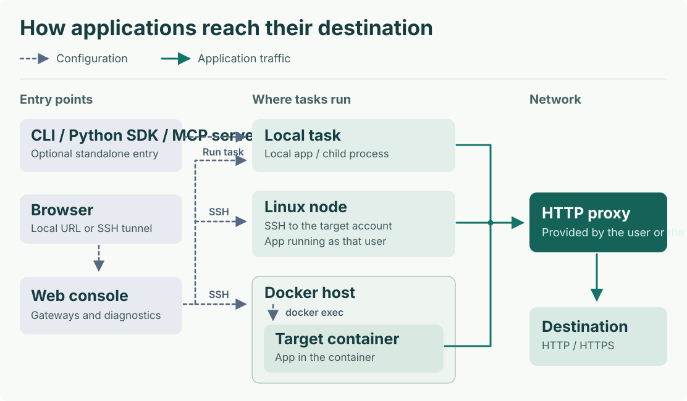
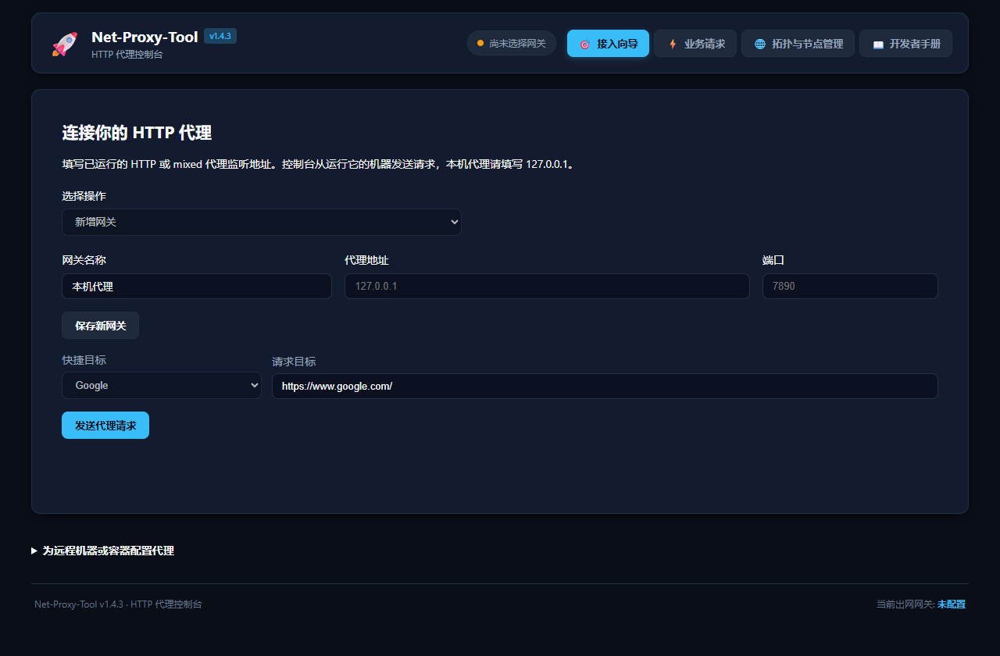

# net-proxy-tool

[简体中文](README.md) · [Quick start](QUICKSTART_EN.md) · [Operations](docs/operations_en.md) · [Changelog](CHANGELOG.md)

Use a local Web console to route a command, a Python task or a selected remote node through an existing HTTP proxy. Test a request in the browser before choosing which workloads should use the gateway.

## Download and open the console

| System | Download v1.4.0 | Start after extracting |
| --- | --- | --- |
| Windows | [x64 · ZIP](https://github.com/xuarehere/net-proxy-tool/releases/download/v1.4.0/net-proxy-tool-windows-x64.zip) | `Start.bat` |
| macOS | [Apple Silicon · tar.gz](https://github.com/xuarehere/net-proxy-tool/releases/download/v1.4.0/net-proxy-tool-macos-arm64.tar.gz) | `./net-proxy-tool` |
| macOS | [Intel · tar.gz](https://github.com/xuarehere/net-proxy-tool/releases/download/v1.4.0/net-proxy-tool-macos-x64.tar.gz) | `./net-proxy-tool` |
| Linux · glibc | [x86_64 · tar.gz](https://github.com/xuarehere/net-proxy-tool/releases/download/v1.4.0/net-proxy-tool-linux-x64.tar.gz) | `./net-proxy-tool` |
| Linux · glibc | [ARM64 · tar.gz](https://github.com/xuarehere/net-proxy-tool/releases/download/v1.4.0/net-proxy-tool-linux-arm64.tar.gz) | `./net-proxy-tool` |

1. **Extract the entire archive** and open its `net-proxy-tool` folder. On Windows, double-click `Start.bat`. On macOS or Linux, run `./net-proxy-tool` in that folder. The release archives include Python.
2. In the browser, enter the **host and HTTP or mixed port** of a running proxy, then save it. Use `127.0.0.1` when the proxy client runs on the same computer. Read the port from that client's settings.
3. Click **发送代理请求** (Send proxy request). A successful HTTP status from your target completes the first request.

For checksums, source installation, shutdown and port conflicts, see the [quick start](QUICKSTART_EN.md). [Release assets and checksums](https://github.com/xuarehere/net-proxy-tool/releases/tag/v1.4.0)

## Where requests travel

The browser connects locally or through an SSH tunnel. Dashed lines show the console starting a local task, configuring a Linux account over SSH or using `docker exec` on a host to reach its container. The CLI and SDK can run local tasks independently. Solid lines follow each application's request through the user's HTTP proxy to its destination. [Open the full-size SVG to zoom on mobile](docs/assets/architecture.en.svg)

## Choose where the proxy applies

| Use case | Entry point | Scope |
| --- | --- | --- |
| Run Git, curl or pip through a proxy once | Web console or CLI | The child process and its descendants |
| Use a proxy in part of a Python program | `with ProxySession():` | Process-wide proxy variables, restored when the block exits |
| Manage Linux hosts and containers | Node management in the Web console | The selected remote account, tool configuration or container until changed |

## Documentation

- [Quick start](QUICKSTART_EN.md) covers the first proxy request, running from source and the Python SDK.
- [Operations and troubleshooting](docs/operations_en.md) covers settings, upgrades, SSH, containers and logs.
- [Security policy](SECURITY.md) describes the console's permissions, credential handling and vulnerability reporting.
- [Contributing](CONTRIBUTING.md) explains how to test changes and regenerate the architecture diagrams.

[MIT license](LICENSE)
